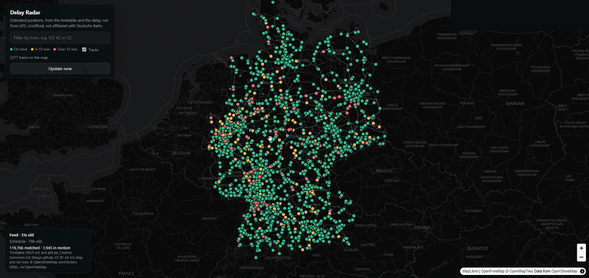

# Delay Radar

A live map of trains in Germany. Each dot is a train, colored by how late it is. Click one for the line, the next stop, the delay, and the stops after that.

The demo is at [https://northquill.xyz/delay_radar/](https://northquill.xyz/delay_radar/).



Unofficial, and not affiliated with Deutsche Bahn.

## Why the positions are estimated

The realtime feed has trip updates and alerts only. It has no GPS and no `VehiclePosition` messages, so nothing in the feed says where a train is.

The map places a train from the timetable and the delay. For each stop, the predicted time is the scheduled clock time plus that stop's delay. "Now" falls on the leg between the predicted departure of one stop and the predicted arrival of the next. The dot sits at that fraction of the OpenStreetMap route between those two stops. Where that route is missing, it sits at the same fraction of the straight line. A train that has arrived and not yet departed is drawn at the station.

A delay is per stop, and it changes along the trip. A stop with no update keeps the previous stop's delay. Stops before the first update stay on time. A delay learned later is not copied backward onto stops the train has already left. Times past 24:00 belong to the service date in the realtime message, which can be yesterday for a train still running after midnight.

## Data and licenses

| Source | What it provides | License |
| --- | --- | --- |
| [gtfs.de](https://gtfs.de) `germany/free` | National timetable. The file says the data is from DELFI e.V. | Creative Commons 4.0, as published by gtfs.de |
| [gtfs.de realtime](https://realtime.gtfs.de/realtime-free.pb) | Trip updates and alerts. Delays, cancellations, skipped stops. | CC BY-SA 4.0 |
| [OpenFreeMap](https://openfreemap.org/) | Dark map tiles | © OpenStreetMap contributors, ODbL |
| OpenStreetMap rail lines | Track geometry the trains follow, and the lines drawn on the map | © OpenStreetMap contributors, ODbL |

`attributions.txt` in the timetable names DELFI e.V., gtfs.de, and OpenStreetMap contributors. The long-distance file `fv_free` is only a fallback if the full timetable cannot be downloaded. Buses, trams, metro, and ferries are in the realtime feed and are not drawn. Rail here is GTFS `route_type` 2, which in this feed includes ICE, regional trains, and S-Bahn.

## Limitations

- Positions are estimates. The dot follows a routed OpenStreetMap track between the two stops when that path is cached. Where routing failed, the dot is still a straight line. The full timetable has no `shapes.txt`.
- The timetable is published as a daily file and can still be a day old or more. On 23 Nov 2026 the copy we used was last modified on 21 Nov.
- The delay drawn for a moving train is the upcoming stop's arrival delay. If that stop had no update of its own, the number was carried forward and the detail panel says so.
- The delay feed is fetched every 3 minutes. **Update now** fetches it sooner. A second click within 15 seconds reuses the copy just loaded, so the button cannot hammer gtfs.de. Each fetch is an 11 MB protobuf, not a GPS tick.
- Trips with fewer than two stops after skipped calls are not placed. Canceled trips are not placed.
- The line name comes from the static timetable. The realtime message leaves `route_id` empty.
- If gtfs.de changes its trip ids, the join breaks until the timetable is refreshed.

## Run locally

Windows, with the project virtualenv:

```text
.venv\Scripts\python -m pip install -r requirements.txt
.venv\Scripts\python -m delay_radar serve
.venv\Scripts\python -m delay_radar serve --replay latest
```

The map is at [http://127.0.0.1:8000](http://127.0.0.1:8000). `serve` uses the live delay feed. `--replay latest` uses the newest snapshot under `data/snapshots/` and freezes the clock at that feed's timestamp, so the dots do not depend on gtfs.de being up.

```text
.venv\Scripts\python -m delay_radar record
.venv\Scripts\python -m delay_radar replay latest
```

`record` stores the raw zip and protobuf. `replay` prints the same report as a live run, with the clock frozen. The first live or record run builds a SQLite database of rail stop times. That scans a 2 GB `stop_times.txt` once. Later runs reuse the database. The timetable is checked at most once a day. A failed download or an HTTP 429 keeps the last saved feed and the page shows a banner.

Track geometry is a separate one-time build. `serve` only reads the cache, so the map runs without it and falls back to straight lines.

```text
.venv\Scripts\python -m pip install osmium
.venv\Scripts\python -m delay_radar.railbuild
```

`railbuild` downloads the Geofabrik file `germany-latest.osm.pbf`, about 4.6 GB, filters it to `railway=rail`, `light_rail`, and `narrow_gauge`, then deletes that pbf. The files it keeps are `data/osm/rail.sqlite`, `data/cache/track-legs.sqlite`, `data/cache/tracks.geojson`, and `data/cache/tracks-minor.geojson`. A later run reuses `rail.sqlite` and does not download the pbf again. Copy those four files to another machine to skip the download. Sidings are in `tracks-minor.geojson` and the map loads them only at zoom 12 and closer. The Tracks checkbox starts on.

## Tests

```text
.venv\Scripts\python -m unittest discover -s tests
```

The tests cover the estimator (overnight trips, dwell, carry-forward, skipped stops, sequence 0), the GeoJSON delay bands, feed fallback and rate-limit backoff, and the `/delay_radar` base path. They do not download gtfs.de.

GitHub Actions runs the same command on push and pull request.

## Deploy

The running demo is [https://northquill.xyz/delay_radar/](https://northquill.xyz/delay_radar/).

```text
docker build -t delay-radar .
docker run -d --name delay-radar --restart unless-stopped \
  -p 8000:8000 \
  -e DELAY_RADAR_DATA=/data \
  -v /path/to/data:/data \
  delay-radar
```

The container serves the map on port 8000. Mount a `data` directory at `DELAY_RADAR_DATA`. That directory holds the timetable and, once built, the track cache. Copy `data/cache` from a machine that already has it and the container skips the download. A first boot with an empty directory downloads about 300 MB and scans `stop_times.txt` once. `GET /health` answers before that finishes.

Set `DELAY_RADAR_ROOT=/delay_radar` when the page is published under that path. The value is the prefix on the page's links. The process still serves `/`.

## Design decisions

**The timetable and the realtime feed did not match.** The long-distance file `fv_free` has the same publisher as the realtime feed and still matched 85 of about 65,000 trip updates. The rest are regional trains, S-Bahn, and buses. DELFI's own GTFS and Transitous use different id schemes, so they cannot be joined to `realtime.gtfs.de`. The full gtfs.de file `germany/free` uses the same short trip ids as the realtime feed. On the snapshot recorded for this project it matched 80,889 of 80,889 trip updates. The line name is read from static `routes.txt` because every realtime trip update has an empty `route_id`.

**One delay for the whole train was the wrong model.** The feed's delay changes from stop to stop, and many stops are missing from an update. The estimator walks the stops in order, carries the last known delay forward, and leaves earlier stops on time. Placement uses those predicted times, not the fraction of the scheduled running time. A train whose departure is delayed stays on the previous leg. A train sitting at a station is drawn on the station. Duplicate updates for the same trip and service date collapse to the copy with more stop updates.

**The timetable has no track shapes.** `germany/free` has no `shapes.txt`. The track lines come from OpenStreetMap (`railway=rail`, `light_rail`, and `narrow_gauge`, without abandoned or disused ways). Each distinct pair of consecutive stops is routed once along that graph and cached. The estimator walks that polyline by distance. A pair that cannot be snapped or routed stays a straight line, and the run counts those. The map draws those lines under the trains. Sidings stay off until you zoom in. Build it with `.venv\Scripts\python -m delay_radar.railbuild` after `pip install osmium`. The Germany extract is about 4.6 GB and is deleted after the filter. Rail lines are © OpenStreetMap contributors, ODbL.
